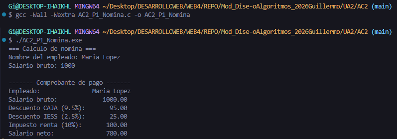
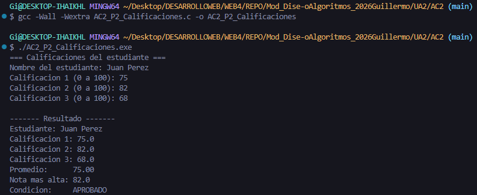
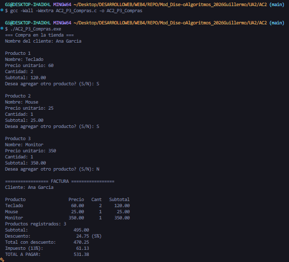

# AC2 · Mi primera aplicación en C

**Estudiante:** (Guillermo Godinez Chacon)  
**Fecha:** 20/10/2026  
**Módulo:** CSTI12010 Diseño de algoritmos · UA2

## Problema 1 · Nómina (AC2_P1_Nomina.c)

| Datos de entrada   | Proceso                                                                               | Datos de salida                            | Limitaciones                            |
| ------------------ | ------------------------------------------------------------------------------------- | ------------------------------------------ | --------------------------------------- |
| Maria Lopez - 1000 | Con la informacion brindada se calculan los diversos rebajos para dar el salario neto | Salario Bruto-Rebajas: CCSS, IESS y renta. | El usuario puede digitar datos erroneos |

**Ejecución con los datos del ejemplo:**

## Problema 2 · Calificaciones (AC2_P2_Calificaciones.c)

| Datos de entrada      | Proceso                                                                                                             | Datos de salida                                        | Limitaciones                               |
| --------------------- | ------------------------------------------------------------------------------------------------------------------- | ------------------------------------------------------ | ------------------------------------------ |
| Juan Perez - 75-82-68 | Con el nombre y las 3 notas brindadas se hacen los calculos respectivos para determinar la condicion del estudiante | Nombre del estudiante-Promedio-Nota mas alta-Condicion | El digitador puede ingresar datos erroneos |

**Ejecución con los datos del ejemplo:**

## Problema 3 · Compras (AC2_P3_Compras.c)

| Datos de entrada                                    | Proceso                                                                                                                                                                                                                | Datos de salida                                                                                                        | Limitaciones                                 |
| --------------------------------------------------- | ---------------------------------------------------------------------------------------------------------------------------------------------------------------------------------------------------------------------- | ---------------------------------------------------------------------------------------------------------------------- | -------------------------------------------- |
| Nombre del Cliente, productos, cantidades y precios | Con la informacion solicitada en los datos de entrada se hacen los calculos correspondientes: Nombres de los productos, cantidades, precios tanto totales como a pagar y los descuentos y se presentan en una factura. | Una factura que muestra: Nombre del cliente, productos, cantidades, subtotal, descuentos, impuestos y el total a pagar | El dependiente puede ingresar datos erroneos |

**Ejecución con los datos del ejemplo:**

## Conclusión

Excelentes ejercicios de evaluacion que me emplearon a fondo.
Favor de Calificar los Problemas 1 y 2 para su respectiva evaluacion. 
